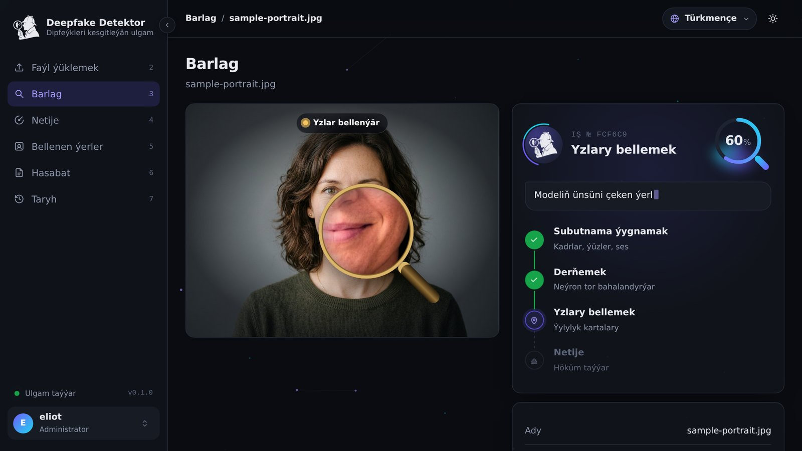

<p align="center">
  <picture>
    <source media="(prefers-color-scheme: dark)" srcset="docs/assets/logo-dark.png">
    
  </picture>
</p>

<h1 align="center">Deepfake Detektor</h1>

<p align="center">
  <b>Wideo, surat we sesiň hakykydygyny ýa-da galpdygyny barlaýan web ulgam</b><br>
  ýüz çalşygyny we emeli sesi kesgitleýär · ähtimallygy göterimde görkezýär · şübheli ýerleri belleýär · PDF hasabat berýär
</p>

<p align="center">
  <a href="https://github.com/eliotlastdance00-art/Find/actions/workflows/ci.yml"></a>
  
  
  
  <a href="LICENSE"></a>
</p>

<p align="center">
  <a href="#install">Gurnamak</a> &nbsp;•&nbsp;
  <a href="#features">Mümkinçilikler</a> &nbsp;•&nbsp;
  <a href="#how">Nähili işleýär</a> &nbsp;•&nbsp;
  <a href="#results">Ölçenen netijeler</a> &nbsp;•&nbsp;
  <a href="#limits">Çäklendirmeler</a> &nbsp;•&nbsp;
  <a href="#english">English</a>
</p>

<p align="center">
  
</p>

<p align="center">
  
</p>

<p align="center"><sub>
  Suratlar işläp duran ulgamdan alyndy. Mysaldaky portret emeli aň bilen <b>doly döredilen</b>, emma model ony
  «Hakyky» diýýär: ol diňe ýüz çalşygyny tanamagy öwrendi. Bu — ulgamyň hakyky çägi, seret: <a href="#limits">Çäklendirmeler</a>.
</sub></p>

<a id="features"></a>
## ✨ Mümkinçilikler

| | Menýu | Näme edýär |
|---|---|---|
| 🔐 | **Giriş** | Hasaba girmek / hasap döretmek (Argon2id, JWT) |
| 📤 | **Faýl ýüklemek** | Wideo, surat ýa-da ses — süýräp goýmak ýa-da saýlamak. Faýlyň görnüşi adyna däl-de, mazmunyna görä tanalýar; ýaramaýan faýl düşnükli habar bilen yzyna gaýtarylýar |
| 🔬 | **Barlag** | Kadrlara bölmek → ýüzi tapyp kesmek → sesi taýýarlamak → neýron tor. Ädimler göni wagtda görkezilýär |
| 📊 | **Netije** | Galp bolmak ähtimallygy (%), höküm (**Hakyky / Şübheli / Galp**), kadrlar we ses bölekleri boýunça grafikler |
| 🔥 | **Bellenen ýerler** | Grad-CAM ýylylyk kartalary: modeliň ünsüni çeken ýerler |
| 📄 | **Hasabat** | PDF hasabat — türkmen, rus ýa-da iňlis dilinde |
| 🕘 | **Taryh** | Öňki barlaglar, gözleg, süzgüçler, statistika (SQLite) |

Interfeýs üç dilde (**türkmençe, rusça, iňlisçe**), açyk we garaňky reňk tertibinde, telefon
ekranyna uýgunlaşýar. Ähli zat öz kompýuteriňizde işleýär: faýllar hiç ýere iberilmeýär.

<a id="install"></a>
## 🚀 Gurnamak

Modeller ammaryň içinde — aýratyn ýüklemek gerek däl. Usuly saýlaň:

| Usul | Haçan laýyk | Näme gerek |
|---|---|---|
| 🍎 [macOS](#macos) · 🐧 [Linux](#linux) · 🪟 [Windows](#windows) | öz kompýuteriňizde işletmek | Python 3.11–3.13, Git |
| 🐳 [Docker](#docker) | bir buýruk bilen, ulgama hiç zat gurmazdan | Docker |
| ☁️ [GitHub Codespaces](#codespaces) | brauzerde synap görmek, hiç zat ýüklemän | mugt GitHub hasaby |

**Talaplar:** 2 GB boş operatiw ýat (ulgam ≈1,2 GB ulanýar), ≈2 GB disk, ilkinji gurnama üçin
internet (≈300 MB ýüklenýär). GPU gerek däl. FFmpeg aýratyn gurmak gerek däl.

<a id="macos"></a>
<details open>
<summary><b>🍎 macOS</b> (Apple Silicon: M1 we täzeler)</summary>

<br>

1\. Python we Git bardygyny barlaň:

```bash
python3 --version    # 3.11, 3.12 ýa-da 3.13 bolmaly
git --version        # ýok bolsa, macOS özi gurmagy teklip eder
```

Python ýok, köne ýa-da **3.14 we ondan täze** bolsa (Homebrew häzir şony gurýar; bu taslama 3.14-de synalmady):
`brew install python@3.13`, soň aşakdaky `python3` ýerine `python3.13` ýazyň.

2\. Ýükläň we gurnaň:

```bash
git clone --depth 1 https://github.com/eliotlastdance00-art/Find.git
cd Find
python3 -m venv .venv
source .venv/bin/activate
pip install torch torchvision --index-url https://download.pytorch.org/whl/cpu
pip install -e .
```

3\. Işlediň:

```bash
dfd serve
```

Brauzerde <http://localhost:8000> açyň. macOS-da buýruk `python` däl-de, **`python3`**.
Intel prosessorly Mac üçin [Docker](#docker) ulanyň (PyTorch-yň täze wersiýalary ony goldamaýar).

</details>

<a id="linux"></a>
<details>
<summary><b>🐧 Linux</b> (Debian, Ubuntu we beýlekiler)</summary>

<br>

1\. Python we Git:

```bash
sudo apt update && sudo apt install -y python3 python3-venv python3-pip git   # Debian / Ubuntu
# Fedora: sudo dnf install -y python3 git
```

2\. Ýükläň we gurnaň:

```bash
git clone --depth 1 https://github.com/eliotlastdance00-art/Find.git
cd Find
python3 -m venv .venv
source .venv/bin/activate
pip install torch torchvision --index-url https://download.pytorch.org/whl/cpu
pip install -e .
```

3\. Işlediň:

```bash
dfd serve
```

Brauzerde <http://localhost:8000> açyň. Başga kompýuterden girmek üçin: `dfd serve --host 0.0.0.0`.

</details>

<a id="windows"></a>
<details>
<summary><b>🪟 Windows</b> 10 / 11 (PowerShell)</summary>

<br>

1\. Python we Git (eýýäm bar bolsa, geçiň). Gurlandan soň PowerShell-i ýapyp, täzeden açyň:

```powershell
winget install -e --id Python.Python.3.13
winget install -e --id Git.Git
```

2\. Ýükläň we gurnaň:

```powershell
git clone --depth 1 https://github.com/eliotlastdance00-art/Find.git
cd Find
py -m venv .venv
.venv\Scripts\Activate.ps1
pip install torch torchvision --index-url https://download.pytorch.org/whl/cpu
pip install -e .
```

3\. Işlediň:

```powershell
dfd serve
```

Brauzerde <http://localhost:8000> açyň. `Activate.ps1` «running scripts is disabled» diýse, bir gezek
şuny işlediň: `Set-ExecutionPolicy -Scope CurrentUser RemoteSigned`.

</details>

<a id="docker"></a>
<details>
<summary><b>🐳 Docker</b> (islendik ulgam)</summary>

<br>

```bash
git clone --depth 1 https://github.com/eliotlastdance00-art/Find.git
cd Find
docker compose up --build
```

Brauzerde <http://localhost:8000> açyň. Maglumatlar `dfd-data` tomunda saklanýar.
Sazlamak isleseňiz: `cp .env.example .env` we içini düzediň.

</details>

### Gurnandan soň

| Näme | Nädip |
|---|---|
| Ilkinji giriş | Giriş sahypasynda hasap dörediň — **ilkinji hasap administrator bolýar** |
| Indiki gezek işletmek | `cd Find`, soň `source .venv/bin/activate` (Windows: `.venv\Scripts\Activate.ps1`), soň `dfd serve` |
| Duruzmak | Terminalda `Ctrl + C` |
| Täzelemek | `git pull`, soň `pip install -e .` |
| Başga port | `dfd serve --port 8080` |
| Hasap döretmek (terminaldan) | `dfd create-user <at> --admin` |
| Gurlan modelleri görmek | `dfd models` |

### 🩹 Näsazlyk çyksa

| Alamat | Sebäbi we çözgüdi |
|---|---|
| `command not found: python` | macOS / Linux-da `python3`, Windows-da `py` ýazyň |
| `command not found: dfd` | Gurşaw işjeň däl ýa-da gurnama tamamlanmady: gurşawy işjeňleşdiriň, soň `pip install -e .` |
| `... is not a supported wheel on this platform` | Ýüklenen `.whl` başga Python wersiýasy üçin (`cp313` = Python 3.13). `python --version` bilen deňeşdiriň; gurşawy `python3.13 -m venv .venv` bilen täzeden dörediň |
| `JSONDecodeError` ýa-da `Unterminated string` (pip-de) | Internet kesilip, sanaw ýarym ýüklendi. Şol buýrugy gaýtalaň: `pip install --no-cache-dir --retries 10 -e .` |
| `IncompleteRead`, `Connection broken` (PyTorch ýüklenende) | Internet kesildi. Aşakdaky «Haýal internet» usulyny ulanyň |
| `RPC failed; curl 18` (`git clone`-da) | Internet kesildi. `--depth 1` bilen synaň ýa-da [ZIP](https://github.com/eliotlastdance00-art/Find/archive/refs/heads/main.zip) ýükläň |
| `Address already in use` | 8000-nji port eýeli: `dfd serve --port 8080` |
| Ilkinji barlag haýal | Model ýada ilkinji barlagda ýüklenýär; soňkular çalt (wideo ≈10 s) |

<details>
<summary><b>🐢 Haýal ýa-da durnuksyz internet</b> — PyTorch-y kesilse dowam edýän usul bilen ýüklemek</summary>

<br>

`pip` kesilen ýüklemäni başdan başlaýar, `curl` bolsa galan ýerinden dowam edýär. Faýlyň anyk
adyny `pip`-iň `Downloading torch-…whl` diýen setirinden alyň, soň:

```bash
# macOS / Linux — kesilse, şol buýrugy gaýtalaň
curl -L -C - --retry 20 --retry-all-errors -O https://download.pytorch.org/whl/cpu/<torch-…>.whl
pip install ./torch-*.whl
pip install -e .
```

```powershell
# Windows (curl.exe diýip ýazmaly)
curl.exe -L -C - --retry 20 -O https://download.pytorch.org/whl/cpu/<torch-…>.whl
pip install (Get-Item .\torch-*.whl).FullName
pip install -e .
```

</details>

<a id="codespaces"></a>
### ☁️ Bulutda mugt synap görmek (GitHub Codespaces)

Kompýutere hiç zat gurmazdan, brauzerde işledip görmek üçin. Mugt GitHub hasaby ýeterlik
(bank karty gerek däl): aýda 60 sagat, 2 ýadro, 8 GB RAM.

[](https://codespaces.new/eliotlastdance00-art/Find?quickstart=1)

1. Ýokardaky düwmä basyň (ýa-da GitHub-da **Code → Codespaces → Create codespace on main**).
2. Birinji gezek 4–5 minut garaşyň: baglylyklar gurulýar we serwer öz-özünden işe başlaýar
   (soňky açylyşlarda 1–2 minut).
3. Terminalda salgy we administrator paroly çykýar (islendik wagt: `bash scripts/codespace.sh info`).

<details>
<summary>Bilmeli zatlar: açyk salgy, çäkler, täzelemek</summary>

<br>

- Salgy (`https://<codespace-ady>-8000.app.github.dev`) hemmelere açyk: GitHub hasaby gerek däl,
  ilkinji gezek GitHub-yň duýduryş sahypasynda **Continue** basmaly. Salgyny bilýän her kim
  hasap açyp biler; islemeseňiz ammaryň düýbünde `.env` faýlyna `DFD_ALLOW_REGISTRATION=false`
  ýazyp, `restart` ediň. Salgyny diňe özüňize galdyrmak üçin `.devcontainer/devcontainer.json`
  içinde `DFD_PUBLIC_PORT`-y `"false"` ediň.
- Bu hemişelik hosting däl. Salgy diňe gurşaw işläp durka açylýar; gurşaw ulanylmasa durýar
  (30 minut, GitHub sazlamalarynda 240 minuda çenli) we iň köp 12 sagat yzygiderli işleýär.
  Duran gurşawy diňe eýesi <https://github.com/codespaces> sahypasyndan açyp bilýär; şonda
  serwer özi işe başlaýar, maglumatlar saklanýar, salgy üýtgemeýär.
- Dolandyryş: `bash scripts/codespace.sh {start|stop|restart|update|info|logs}`.
- Täzelemek: `bash scripts/codespace.sh update` (GitHub-dan iň täze wersiýany alýar we serweri
  täzeden başlaýar). Codespace her gezek işe başlanda hem özi täzelenýär (`DFD_AUTO_UPDATE`).

</details>

## ⚙️ Sazlamalar

Hemmesi hökmany däl. Gurşaw üýtgeýjileri hökmünde ýa-da ammaryň düýbündäki `.env` faýlynda
berilýär (doly sanaw: [.env.example](.env.example)).

| Üýtgeýji | Başlangyç | Manysy |
|---|---|---|
| `DFD_ADMIN_USERNAME`, `DFD_ADMIN_PASSWORD` | — | Başlangyçda döredilýän administrator. Berilmese, ilkinji hasap administrator bolýar |
| `DFD_ALLOW_REGISTRATION` | `true` | Giriş sahypasynda hasap döretmäge rugsat |
| `DFD_MAX_UPLOAD_MB` | `200` | Faýlyň iň uly ölçegi |
| `DFD_MAX_DURATION_S` | `600` | Wideo / sesiň iň uzyn dowamlylygy (sekunt) |
| `DFD_VIDEO_FRAMES` | `24` | Wideodan alynýan kadr sany |
| `DFD_DEVICE` | `auto` | `auto`, `cpu` ýa-da `cuda` |
| `DFD_DATA_DIR` | `data` | Maglumat bazasy we ýüklenen faýllar saklanýan papka |

<a id="how"></a>
## 🧠 Nähili işleýär

```
faýl ─► görnüşini anyklamak ─► taýýarlamak ─────────────► seljermek ───────────► netije
        (mazmuny boýunça)      wideo: kadrlar (FFmpeg/OpenCV)   EfficientNet-B4      ähtimallyk %
                               ýüz: YuNet → kesmek              AASIST (ses)         Hakyky/Şübheli/Galp
                               ses: 16 kHz mono, 4 s bölekler   Grad-CAM             PDF hasabat, taryh
```

* **Şekil (ýüz çalşygy):** EfficientNet-B4, FaceForensics++ (c23) maglumatlarynda okadyldy.
* **Ses (emeli ses):** AASIST, ASVspoof 2019 LA; awtorlaryň resmi agramlary.
* **Düşündiriş:** Grad-CAM — ýüzüň haýsy ýerleri «galp» bahasyna täsir edendigini görkezýär.
* **Höküm:** iki bosaga barlag maglumatlarynda saýlanýar; aralykdaky bahalar «Şübheli».
  Wideoda ses diňe goşmaça subutnama — ol hökümi «Şübheli» derejesine çenli ýokarlandyryp bilýär.
  Ýüz tapylmasa we ses bolmasa, ulgam çak etmeýär: «kesgitläp bolmady» diýýär.

Jikme-jik: [docs/ARCHITECTURE.md](docs/ARCHITECTURE.md).

<a id="results"></a>
## 📊 Modeller we ölçenen netijeler

Bu ýerde diňe hakykatdan ölçenen sanlar ýazylýar. Çig maglumatlar: `docs/metrics/`.

| Model | Maglumat | AUC | EER | Bellik |
|---|---|---|---|---|
| Şekil — EfficientNet-B4 | FaceForensics++ c23, synag bölegi (840 wideo) | 0.9914 | 3.00 % | wideo boýunça |
| Ses — AASIST | ASVspoof 2019 LA, eval-dan 3000 ýazgy | 0.9991 | 1.62 % | deslapky; diňe iňlis dili |

<details>
<summary>Jikme-jik jedweller</summary>

<br>

### Ses — AASIST (deslapky ölçeg)

Awtorlaryň resmi agramlary (gaýtadan okadylmady). ASVspoof 2019 LA toplumynyň **tötänleýin
böleginde** ölçendi: dev-den 3000 ýazgy (temperatura we bosagalary saýlamak üçin), eval-dan
3000 ýazgy (synag üçin; 304 hakyky, 2696 galp). Doly toplum bilen ölçeg entek geçirilmedi,
şonuň üçin model karty `provisional` diýlip bellenen.

| Görkeziji | dev (3000) | eval (3000) |
|---|---|---|
| AUC | 0.9998 | 0.9991 |
| EER | 0.38 % | 1.62 % |

Eval böleginde höküm (bosagalar: ≤ 3.0 % — Hakyky, ≥ 99.0 % — Galp, arasy — Şübheli):

| Hakykatda | Hakyky | Şübheli | Galp |
|---|---|---|---|
| Hakyky ses (304) | 96.4 % | 3.6 % | 0 % |
| Galp ses (2696) | 0.7 % | 34.8 % | 64.6 % |

Galp sesleriň üçden biri «Şübheli» bolýar: eval böleginde bosagalar saýlananda görülmedik
13 usul (A07–A19) bar. Iň kyn usullar: A18 (EER 4.9 %), A17 (3.0 %).

### Şekil — EfficientNet-B4

FaceForensics++ (c23) toplumynda okadyldy (`training/train_visual.py`, Kaggle 2×T4, 12 epoha,
iň gowy — 7-nji epoha). Toplumyň **resmi bölünişi** ulanyldy: okuw 4320 wideo, barlag
(validation) 840, synag (test) 840; bir adam diňe bir bölekde bar. Temperatura we bosagalar
barlag böleginde saýlandy, aşakdaky sanlar bolsa modeliň hiç görmedik **synag böleginde** ölçendi
(140 hakyky + 700 galp wideo; 2240 + 11200 kadr).

| Görkeziji | Kadr (surat) | Wideo |
|---|---|---|
| AUC | 0.9832 | 0.9914 |
| EER | 5.27 % | 3.00 % |
| Takyklyk (bosaga 0.5) | 95.10 % | 96.55 % |

Synag böleginde wideo boýunça höküm (bosagalar: ≤ 52.6 % — Hakyky, ≥ 82.8 % — Galp):

| Hakykatda | Hakyky | Şübheli | Galp |
|---|---|---|---|
| Hakyky wideo (140) | 93.6 % | 5.7 % | 0.7 % |
| Galp wideo (700) | 2.3 % | 4.1 % | 93.6 % |

Usullar boýunça wideo AUC: Deepfakes 0.997, FaceShifter 0.996, Face2Face 0.992,
FaceSwap 0.991, NeuralTextures 0.982 (iň kyny).

Bu sanlar diňe FaceForensics++ üçin dogry. Başga toplumlarda (meselem, Celeb-DF) ölçeg
geçirilmedi; adatça şeýle modelleriň takyklygy nätanyş maglumatlarda ep-esli peselýär.
Çig maglumatlar we ROC egrisi: `docs/metrics/visual_effnet_b4_ffpp*`.

</details>

<a id="limits"></a>
## ⚠️ Çäklendirmeler (dogruçyl bellik)

* Netije — awtomatiki modeliň bahasy, kepillik däl. Möhüm karar üçin hünärmeniň barlagy zerur.
* Şekil modeli FaceForensics++ maglumatlaryndaky bäş usuly öwrendi. Başga usullar bilen
  (meselem, doly emeli döredilen suratlar, diffuziýa modelleri, täze face-swap programmalary)
  ýasalan materiallarda takyklyk ep-esli pes bolup biler.
* Güýçli gysylan, kiçi ýa-da garaňky wideolarda hakyky faýl «Şübheli» diýlip bilner.
* Ses modeli diňe **iňlis** dilinde ölçenen. Türkmen dilindäki synagda ol ýalňyşdy (60 hakyky
  ýazgynyň hiç biri «Hakyky» çykmady), şonuň üçin türkmen dilinde okadylan model taýýar bolýança
  ses boýunça höküm «Şübheli» derejesinden ýokary çykarylmaýar (`model_card.json` → `max_verdict`).
* Ses modeli **gürleýiş** üçin okadylan. Aýdym-saz, şowhun ýa-da arassa ton ýaly gürleýiş däl
  seslerde netijä ynanmaly däl (şonuň üçin wideoda ses hökümi «Galp» edip bilmeýär).
* Ulgam diňe ýüzi barlaýar; ýüz ýok bolsa şekil boýunça baha berilmeýär.

## 🛠 Işläp düzmek

```bash
make install     # CPU PyTorch + taslama + gurallar
make check       # ruff + mypy (strict) + pytest
make run
```

Testler hakyky zynjyry (FFmpeg, OpenCV, PyTorch, Grad-CAM, PDF) emeli döredilen faýllarda we
kiçi tötänleýin torlarda işledýär — internet ýa-da GPU gerek däl. GitHub Actions her push-da
lint, tip barlagy, testler (Python 3.11 we 3.13), soňra Docker obrazyny gurup, işledip,
`scripts/smoke_test.py` bilen barlaýar.

Modelleri gaýtadan okatmak (Kaggle GPU): `training/train_visual.py`, ses modelini
kalibrlemek we bahalandyrmak: `training/eval_audio.py`; işe goýbermek üçin
`scripts/kaggle_run.py`.

### Gurluşy

```
src/dfd/domain          arassa logika: düzgünler, höküm, portlar
src/dfd/application     ulanyş ýagdaýlary: giriş, barlag
src/dfd/infrastructure  SQLite, FFmpeg, modeller, Grad-CAM, PDF, howpsuzlyk
src/dfd/presentation    FastAPI + web interfeýs (HTML/CSS/JS, daşarky kitaphanasyz)
training/               modeli okatmak we bahalandyrmak
tests/                  unit we API testleri
weights/                modeller we olaryň kartlary (model_card.json)
```

## 📜 Ygtyýarnama

MIT — [LICENSE](LICENSE). Üçünji taraplaryň materiallary: [THIRD_PARTY_NOTICES.md](THIRD_PARTY_NOTICES.md).

---

<a id="english"></a>
## 🇬🇧 English

A web application that checks whether a video, image or audio file is genuine or
manipulated: face-swap detection (EfficientNet-B4 trained on FaceForensics++), synthetic
voice detection (AASIST, ASVspoof 2019), a fake probability with a three-way verdict
(*Real / Suspicious / Fake*), Grad-CAM heatmaps, PDF reports and a scan history. The UI is
available in Turkmen, Russian and English. Everything runs locally; files are not sent anywhere.

**Run it** (Python 3.11–3.13; model weights are in the repository):

```bash
git clone --depth 1 https://github.com/eliotlastdance00-art/Find.git && cd Find
python3 -m venv .venv && source .venv/bin/activate      # Windows: py -m venv .venv; .venv\Scripts\Activate.ps1
pip install torch torchvision --index-url https://download.pytorch.org/whl/cpu
pip install -e .
dfd serve                                               # http://localhost:8000
```

Or `docker compose up --build`, or open the repository in GitHub Codespaces (the dev container
installs and starts the server on port 8000).

**Stack:** Python, FastAPI, SQLAlchemy/SQLite, PyTorch + timm, OpenCV (YuNet), FFmpeg,
fpdf2; plain HTML/CSS/JS front end with no external assets. Clean architecture
(domain / application / infrastructure / presentation), strict typing (mypy), ruff, and a
test suite that runs the real pipeline on synthetic media. CI runs the tests on Linux, macOS
and Windows and builds and smoke-tests the Docker image. See
[docs/ARCHITECTURE.md](docs/ARCHITECTURE.md) for design and security notes.

**Limitations:** the verdict is a model estimate, not proof. The visual model learned five
face-swap methods and does not recognise fully generated pictures (the portrait in the
screenshots above is AI-generated and is judged *Real*). The audio model was measured on
English only; it fails on Turkmen speech, so audio verdicts are capped at *Suspicious* until a
model trained on Turkmen is ready.
