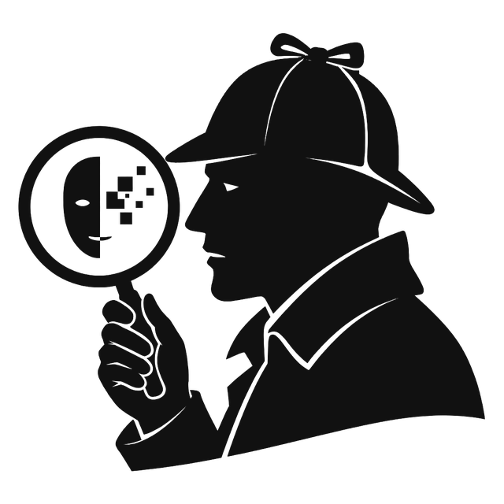
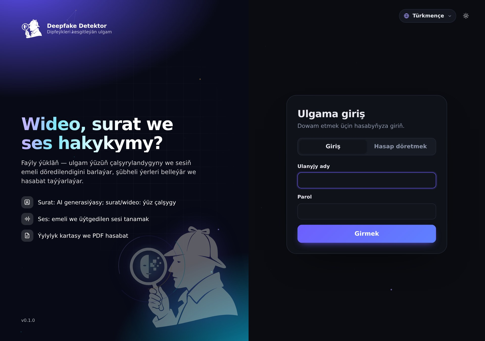
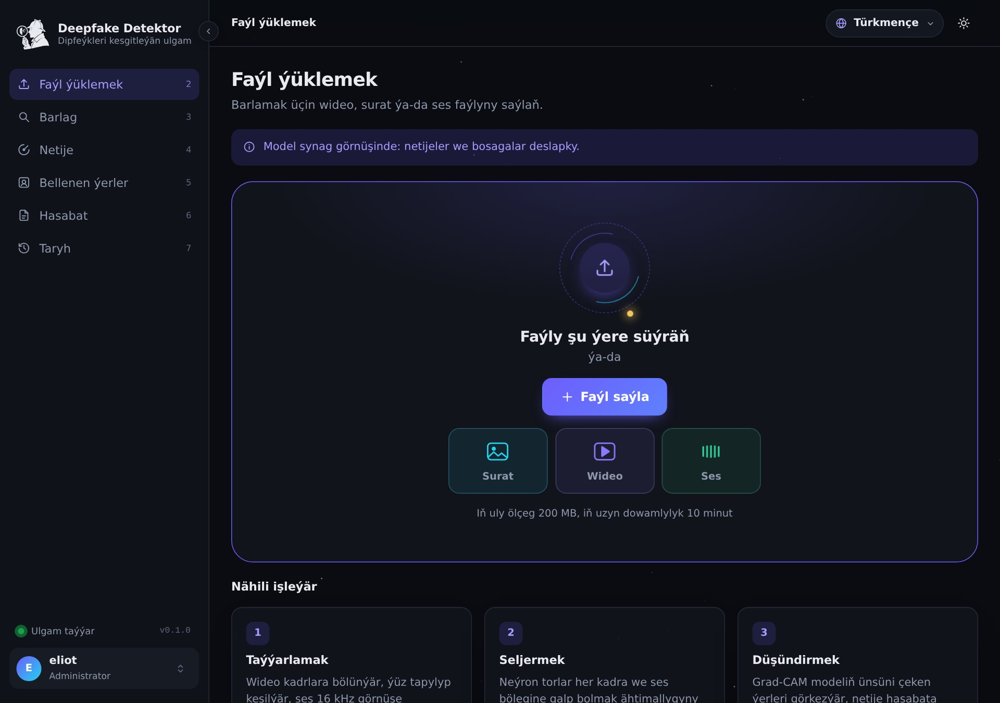
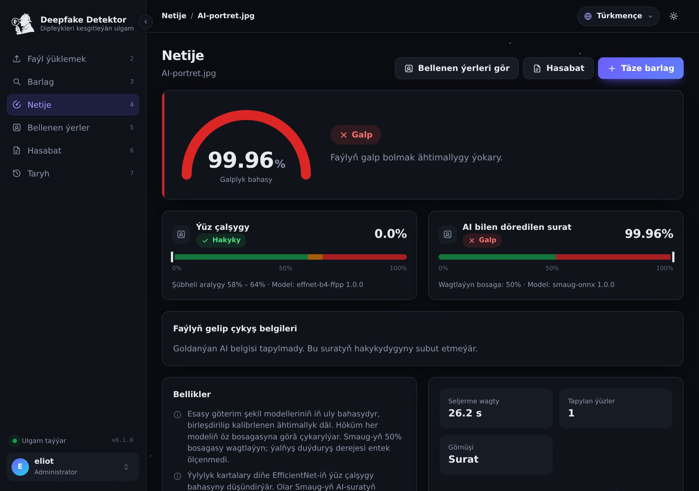
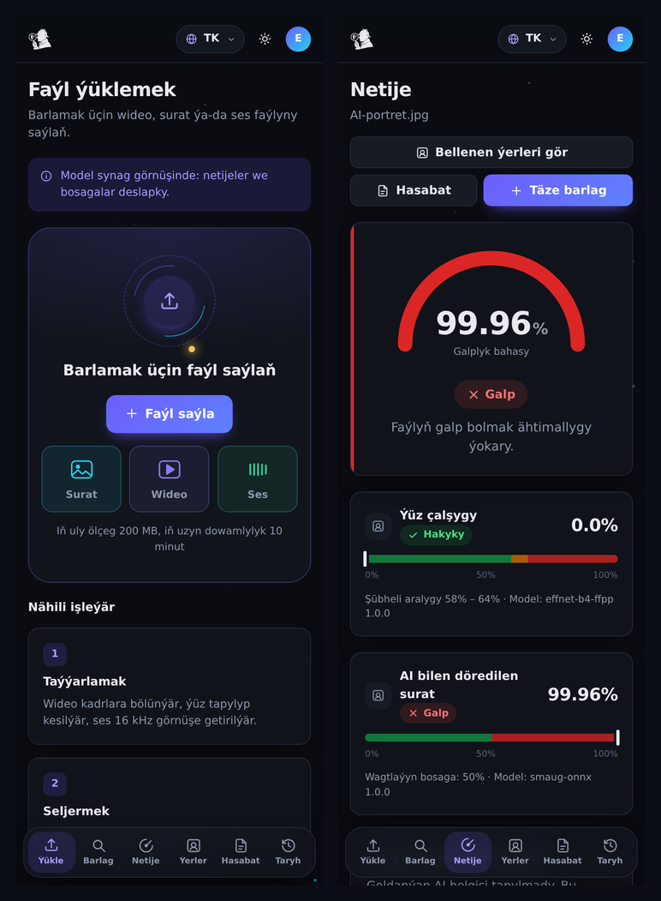

<p align="center">
  <picture>
    <source media="(prefers-color-scheme: dark)" srcset="docs/assets/logo-dark.png">
    
  </picture>
</p>

<h1 align="center">Deepfake Detektor</h1>

<p align="center">
  <b>Wideo, surat we sesiň hakykydygyny ýa-da galpdygyny barlaýan web ulgam</b><br>
  AI suratlaryny, ýüz çalşygyny we emeli sesi barlaýar · ähtimallygy göterimde görkezýär · şübheli ýerleri belleýär · PDF hasabat berýär
</p>

<p align="center">
  <a href="https://github.com/eliotlastdance00-art/Find/actions/workflows/ci.yml"></a>
  <a href="https://github.com/eliotlastdance00-art/Find/releases"></a>
  
  
  
  <a href="LICENSE"></a>
  <a href="https://github.com/eliotlastdance00-art/Find/stargazers"></a>
</p>

<p align="center">
  <a href="#install">Gurnamak</a> &nbsp;•&nbsp;
  <a href="#features">Mümkinçilikler</a> &nbsp;•&nbsp;
  <a href="#how">Nähili işleýär</a> &nbsp;•&nbsp;
  <a href="#results">Ölçenen netijeler</a> &nbsp;•&nbsp;
  <a href="#limits">Çäklendirmeler</a> &nbsp;•&nbsp;
  <a href="#english">English</a>
</p>

<p align="center">
  
</p>

<p align="center">
  
  
</p>

<p align="center">
  
</p>

<p align="center">
  
</p>

<p align="center"><sub>
  Suratlar işläp duran ulgamdan alyndy. Mysaldaky portret AI bilen <b>doly döredilen</b>.
  Smaug goşulandan soň ol «Galp» çykýar (Smaug bahasy 99.96%; bu kepillik däl).
  <a href="docs/SMAUG.md">Birikdirme synagy we çäklendirmeler</a>.
</sub></p>

<a id="features"></a>
## ✨ Mümkinçilikler

| | Menýu | Näme edýär |
|---|---|---|
| 🔐 | **Giriş** | Hasaba girmek / hasap döretmek (Argon2id, JWT) |
| 📤 | **Faýl ýüklemek** | Wideo, surat ýa-da ses — süýräp goýmak ýa-da saýlamak. Faýlyň görnüşi adyna däl-de, mazmunyna görä tanalýar; ýaramaýan faýl düşnükli habar bilen yzyna gaýtarylýar |
| 🔬 | **Barlag** | Kadrlara bölmek → ýüzi tapyp kesmek → sesi taýýarlamak → neýron tor. Ädimler göni wagtda görkezilýär |
| 📊 | **Netije** | Galp bolmak ähtimallygy (%), höküm (**Hakyky / Şübheli / Galp**), kadrlar we ses bölekleri boýunça grafikler |
| 🔥 | **Bellenen ýerler** | Grad-CAM ýylylyk kartalary: modeliň ünsüni çeken ýerler |
| 📄 | **Hasabat** | PDF hasabat — türkmen, rus ýa-da iňlis dilinde |
| 🕘 | **Taryh** | Öňki barlaglar, gözleg, süzgüçler, statistika (SQLite) |

Interfeýs üç dilde (**türkmençe, rusça, iňlisçe**), açyk we garaňky reňk tertibinde, telefon
ekranyna uýgunlaşýar. Ähli zat öz kompýuteriňizde işleýär: faýllar hiç ýere iberilmeýär.

<a id="install"></a>
## 🚀 Gurnamak

Ýüz we ses modelleri ammarda. AI-surat modeli **Smaug** bir gezek `dfd models --download` bilen
ýüklenýär (181 MB, kesilen ýerinden dowam edýär). Docker muny build wagtynda özi edýär. Usuly saýlaň:

| Usul | Haçan laýyk | Näme gerek |
|---|---|---|
| 🍎 [macOS](#macos) · 🐧 [Linux](#linux) · 🪟 [Windows](#windows) | öz kompýuteriňizde işletmek | Python 3.11–3.13, Git |
| 🐳 [Docker](#docker) | bir buýruk bilen, ulgama hiç zat gurmazdan | Docker |
| ☁️ [GitHub Codespaces](#codespaces) | brauzerde synap görmek, hiç zat ýüklemän | mugt GitHub hasaby |

**Talaplar:** azyndan 4 GB RAM maslahat berilýär (OS we birnäçe media modeli üçin ätiýaç), ≈3 GB disk.
Ilkinji gurnama üçin internet gerek: paketler + Smaug 181 MB; soň ähli barlaglar oflaýn.
GPU gerek däl. FFmpeg aýratyn gurmak gerek däl. Bu 2 ýadroly Linux-da üç yzygiderli surat
barlagy 18–24 s/surat, prosesiň iň ýokary ýady ≈1.15 GiB boldy; bu ähli faýllar üçin ýat çägi däl.

<a id="macos"></a>
<details open>
<summary><b>🍎 macOS</b> (Apple Silicon: M1 we täzeler)</summary>

<br>

1\. Python we Git bardygyny barlaň:

```bash
python3 --version    # 3.11, 3.12 ýa-da 3.13 bolmaly
git --version        # ýok bolsa, macOS özi gurmagy teklip eder
```

Python ýok, köne ýa-da **3.14 we ondan täze** bolsa (Homebrew häzir şony gurýar; bu taslama 3.14-de synalmady):
python.org-dan Python 3.13 guruň ýa-da `brew install python@3.13`; soň aşakdaky `python3` ýerine `python3.13` ýazyň.

2\. Ýükläň we gurnaň:

```bash
git clone --depth 1 https://github.com/eliotlastdance00-art/Find.git
cd Find
python3 -m venv .venv
source .venv/bin/activate
pip install torch torchvision --index-url https://download.pytorch.org/whl/cpu
pip install .
dfd models --download
```

3\. Işlediň:

```bash
dfd serve
```

Brauzerde <http://localhost:8000> açyň. macOS-da buýruk `python` däl-de, **`python3`**.
Intel prosessorly Mac üçin [Docker](#docker) ulanyň (PyTorch-yň täze wersiýalary ony goldamaýar).

</details>

<a id="linux"></a>
<details>
<summary><b>🐧 Linux</b> (Debian, Ubuntu we beýlekiler)</summary>

<br>

1\. Python we Git:

```bash
sudo apt update && sudo apt install -y python3 python3-venv python3-pip git   # Debian / Ubuntu
# Fedora: sudo dnf install -y python3 git
```

2\. Ýükläň we gurnaň:

```bash
git clone --depth 1 https://github.com/eliotlastdance00-art/Find.git
cd Find
python3 -m venv .venv
source .venv/bin/activate
pip install torch torchvision --index-url https://download.pytorch.org/whl/cpu
pip install .
dfd models --download
```

3\. Işlediň:

```bash
dfd serve
```

Brauzerde <http://localhost:8000> açyň. Başga kompýuterden girmek üçin: `dfd serve --host 0.0.0.0`.

</details>

<a id="windows"></a>
<details>
<summary><b>🪟 Windows</b> 10 / 11 (PowerShell)</summary>

<br>

1\. Python we Git (eýýäm bar bolsa, geçiň). Gurlandan soň PowerShell-i ýapyp, täzeden açyň:

```powershell
winget install -e --id Python.Python.3.13
winget install -e --id Git.Git
```

2\. Ýükläň we gurnaň:

```powershell
git clone --depth 1 https://github.com/eliotlastdance00-art/Find.git
cd Find
py -m venv .venv
.venv\Scripts\Activate.ps1
pip install torch torchvision --index-url https://download.pytorch.org/whl/cpu
pip install .
dfd models --download
```

3\. Işlediň:

```powershell
dfd serve
```

Brauzerde <http://localhost:8000> açyň. `Activate.ps1` «running scripts is disabled» diýse, bir gezek
şuny işlediň: `Set-ExecutionPolicy -Scope CurrentUser RemoteSigned`.

</details>

<a id="docker"></a>
<details>
<summary><b>🐳 Docker</b> (islendik ulgam)</summary>

<br>

```bash
git clone --depth 1 https://github.com/eliotlastdance00-art/Find.git
cd Find
docker compose up --build
```

Brauzerde <http://localhost:8000> açyň. Maglumatlar `dfd-data` tomunda saklanýar.
Sazlamak isleseňiz: `cp .env.example .env` we içini düzediň.

</details>

### Gurnandan soň

| Näme | Nädip |
|---|---|
| Ilkinji giriş | Giriş sahypasynda hasap dörediň — **ilkinji hasap administrator bolýar** |
| Indiki gezek işletmek | `cd Find`, soň `source .venv/bin/activate` (Windows: `.venv\Scripts\Activate.ps1`), soň `dfd serve` |
| Duruzmak | Terminalda `Ctrl + C` |
| Täzelemek | `git pull`, soň `pip install .`, `dfd models --download`, serweri täzeden işlediň |
| Başga port | `dfd serve --port 8080` |
| Hasap döretmek (terminaldan) | `dfd create-user <at> --admin` |
| Gurlan modelleri görmek | `dfd models` |
| Smaug-y gurnamak / barlamak | `dfd models --download` (bar faýl SHA-256 gabat gelse täzeden ýüklenmeýär) |

<a id="troubleshooting"></a>
### 🩹 Näsazlyk çyksa

| Alamat | Sebäbi we çözgüdi |
|---|---|
| `command not found: python` | macOS / Linux-da `python3`, Windows-da `py` ýazyň |
| `command not found: dfd` | Gurşaw işjeň däl ýa-da gurnama tamamlanmady: gurşawy işjeňleşdiriň, soň `pip install .` |
| `... is not a supported wheel on this platform` | Ýüklenen `.whl` başga Python wersiýasy üçin (`cp313` = Python 3.13). `python --version` bilen deňeşdiriň; gurşawy `python3.13 -m venv .venv` bilen täzeden dörediň |
| `JSONDecodeError`, `Unterminated string`, `incomplete-download` (pip-de) | Internet kesildi. Aşakdaky «Haýal internet» usulyny ulanyň (`scripts/fetch_wheels.py`) |
| Gurnama üstünlikli, ýöne `ModuleNotFoundError: No module named 'dfd'` (macOS, Python 3.13+) | macOS `.venv` içindäki `.pth` faýlyny «gizlin» edip belleýär, Python 3.13 bolsa gizlin `.pth`-ni okamaýar. `-e`-siz guruň: `pip uninstall -y dfd`, soň `pip install .` (her `git pull`-dan soň gaýtalamaly) |
| `IncompleteRead`, `Connection broken` (PyTorch ýüklenende) | Internet kesildi. Aşakdaky «Haýal internet» usulyny ulanyň |
| `RPC failed; curl 18` (`git clone`-da) | Internet kesildi. `--depth 1` bilen synaň ýa-da [ZIP](https://github.com/eliotlastdance00-art/Find/archive/refs/heads/main.zip) ýükläň |
| `Address already in use` | 8000-nji port eýeli: `dfd serve --port 8080` |
| Ilkinji barlag haýal | Model ýada ilkinji barlagda ýüklenýär; soňkular çalt (wideo ≈10 s) |

<details>
<summary><b>🐢 Haýal ýa-da durnuksyz internet</b> — kesilse dowam edýän usul bilen ýüklemek</summary>

<br>

**macOS (Apple Silicon), Python 3.12 ýa-da 3.13 — iň ygtybarly usul.** Ähli paketler (≈250 MB) anyk
sanaw boýunça ýüklenýär: her faýl kesilen ýerinden dowam edýär we SHA-256 bilen barlanýar. Islendik
wagt gaýtadan işledip bolýar, taýýar faýllar gaýtadan ýüklenmeýär.

```bash
source .venv/bin/activate
python scripts/fetch_wheels.py requirements/wheels/macos-arm64-py313.txt   # 3.12 üçin: …-py312.txt
pip install --no-index --find-links wheels .
dfd models --download
```

**Täzelemek:** her `git pull`-dan soň `pip install --no-index --find-links wheels --no-deps --force-reinstall .`
we serweri täzeden işlediň. Baglylyklar üýtgese, ilki wheel sanawyny gaýtadan ýükläň we adaty gurnamany gaýtalaň.
Smaug paketlerden aýratyn ýüklenýär; `dfd models --download` buýrugyny kesilse gaýtalaň.

**Beýleki ulgamlar — diňe PyTorch üçin.** `pip` kesilen ýüklemäni başdan başlaýar, `curl` bolsa galan ýerinden dowam edýär. Faýlyň anyk
adyny `pip`-iň `Downloading torch-…whl` diýen setirinden alyň, soň:

```bash
# macOS / Linux — kesilse, şol buýrugy gaýtalaň
curl -L -C - --retry 20 --retry-all-errors -O https://download.pytorch.org/whl/cpu/<torch-…>.whl
pip install ./torch-*.whl
pip install .
```

```powershell
# Windows (curl.exe diýip ýazmaly)
curl.exe -L -C - --retry 20 -O https://download.pytorch.org/whl/cpu/<torch-…>.whl
pip install (Get-Item .\torch-*.whl).FullName
pip install .
```

</details>

<a id="codespaces"></a>
### ☁️ Bulutda mugt synap görmek (GitHub Codespaces)

Kompýutere hiç zat gurmazdan, brauzerde işledip görmek üçin. Mugt GitHub hasaby ýeterlik
(bank karty gerek däl): aýda 60 sagat, 2 ýadro, 8 GB RAM.

[](https://codespaces.new/eliotlastdance00-art/Find?quickstart=1)

1. Ýokardaky düwmä basyň (ýa-da GitHub-da **Code → Codespaces → Create codespace on main**).
2. Birinji gezek 4–5 minut garaşyň: baglylyklar gurulýar we serwer öz-özünden işe başlaýar
   (soňky açylyşlarda 1–2 minut).
3. Terminalda salgy we administrator paroly çykýar (islendik wagt: `bash scripts/codespace.sh info`).

<details>
<summary>Bilmeli zatlar: açyk salgy, çäkler, täzelemek</summary>

<br>

- Salgy (`https://<codespace-ady>-8000.app.github.dev`) hemmelere açyk: GitHub hasaby gerek däl,
  ilkinji gezek GitHub-yň duýduryş sahypasynda **Continue** basmaly. Salgyny bilýän her kim
  hasap açyp biler; islemeseňiz ammaryň düýbünde `.env` faýlyna `DFD_ALLOW_REGISTRATION=false`
  ýazyp, `restart` ediň. Salgyny diňe özüňize galdyrmak üçin `.devcontainer/devcontainer.json`
  içinde `DFD_PUBLIC_PORT`-y `"false"` ediň.
- Bu hemişelik hosting däl. Salgy diňe gurşaw işläp durka açylýar; gurşaw ulanylmasa durýar
  (30 minut, GitHub sazlamalarynda 240 minuda çenli) we iň köp 12 sagat yzygiderli işleýär.
  Duran gurşawy diňe eýesi <https://github.com/codespaces> sahypasyndan açyp bilýär; şonda
  serwer özi işe başlaýar, maglumatlar saklanýar, salgy üýtgemeýär.
- Dolandyryş: `bash scripts/codespace.sh {start|stop|restart|update|info|logs}`.
- Täzelemek: `bash scripts/codespace.sh update` (GitHub-dan iň täze wersiýany alýar we serweri
  täzeden başlaýar). Codespace her gezek işe başlanda hem özi täzelenýär (`DFD_AUTO_UPDATE`).

</details>

## ⚙️ Sazlamalar

Hemmesi hökmany däl. Gurşaw üýtgeýjileri hökmünde ýa-da ammaryň düýbündäki `.env` faýlynda
berilýär (doly sanaw: [.env.example](.env.example)).

| Üýtgeýji | Başlangyç | Manysy |
|---|---|---|
| `DFD_ADMIN_USERNAME`, `DFD_ADMIN_PASSWORD` | — | Başlangyçda döredilýän administrator. Berilmese, ilkinji hasap administrator bolýar |
| `DFD_ALLOW_REGISTRATION` | `true` | Giriş sahypasynda hasap döretmäge rugsat |
| `DFD_MAX_UPLOAD_MB` | `200` | Faýlyň iň uly ölçegi |
| `DFD_MAX_DURATION_S` | `600` | Wideo / sesiň iň uzyn dowamlylygy (sekunt) |
| `DFD_VIDEO_FRAMES` | `24` | Wideodan alynýan kadr sany |
| `DFD_DEVICE` | `auto` | `auto`, `cpu` ýa-da `cuda` |
| `DFD_DATA_DIR` | `data` | Maglumat bazasy we ýüklenen faýllar saklanýan papka |

<a id="how"></a>
## 🧠 Nähili işleýär

```
faýl ─► görnüşini anyklamak ─► taýýarlamak ─────────────► seljermek ───────────► netije
        (mazmuny boýunça)      wideo: kadrlar (FFmpeg/OpenCV)   EfficientNet-B4      ähtimallyk %
                               ýüz: YuNet → kesmek              AASIST (ses)         Hakyky/Şübheli/Galp
                               ses: 16 kHz mono, 4 s bölekler   Grad-CAM             PDF hasabat, taryh
```

* **Şekil (ýüz çalşygy):** EfficientNet-B4, FaceForensics++ (c23) maglumatlarynda okadyldy.
* **AI-surat:** Smaug ONNX (Apache-2.0), tutuş suratyň üç kesimi; ýüz bolmagy gerek däl. Häzir diňe suratlarda.
* **Gelip çykyş belgileri:** gurluşly PNG/EXIF/XMP bellikleri; gol barlagy däl, özbaşdak höküm bermeýär.
* **Ses (emeli ses):** AASIST; awtorlaryň resmi agramlaryndan başlap, ASVspoof 2019 LA we türkmen ses toplumynda bilelikde okadyldy.
* **Düşündiriş:** Grad-CAM diňe EfficientNet-iň ýüz çalşygy bahasyny düşündirýär; Smaug üçin heatmap ýok.
* **Höküm:** iki bosaga barlag maglumatlarynda saýlanýar; aralykdaky bahalar «Şübheli».
  Wideoda ses diňe goşmaça subutnama — ol hökümi «Şübheli» derejesine çenli ýokarlandyryp bilýär.
  Ýüz tapylmasa Smaug suratdaky AI generasiýasyny şonda-da barlaýar; wideoda ýüz we peýdaly ses ýok bolsa «kesgitläp bolmady».
  Smaug-yň 0.5 bosagasy wagtlaýyn. Iki şekil modeliniň hökmi aýratyn çykarylýar; iň güýçli tapyndy alynýar.
  Esasy göterim iň uly bal — birleşdirilip kalibrlenen ähtimallyk däl.

Jikme-jik: [docs/ARCHITECTURE.md](docs/ARCHITECTURE.md).

<a id="results"></a>
## 📊 Modeller we ölçenen netijeler

Bu ýerde diňe hakykatdan ölçenen sanlar ýazylýar. Çig maglumatlar: `docs/metrics/`.

**Smaug — birikdirme synagy, takyklyk ölçegi däl:** öňki AI portret **99.96% — Galp**;
768×768/JPEG-60, metadata aýrylan nusgasy **99.92% — Galp**; bir hakyky surat **0.016% — Hakyky**
(Smaug bahalary). Bu üç mysaldan AUC ýa-da ýalňyş duýduryş derejesi çykarylmaýar.
Doly sanlar: [smaug_integration_smoke.json](docs/metrics/smaug_integration_smoke.json).
[Smaug gollanmasy](docs/SMAUG.md); [indiki işler we sebäpleri](docs/ROADMAP.md).

| Model | Maglumat | AUC | EER | Bellik |
|---|---|---|---|---|
| Şekil — EfficientNet-B4 | FaceForensics++ c23, synag bölegi (840 wideo) | 0.9914 | 3.00 % | wideo boýunça |
| Ses — AASIST (türkmen dili) | türkmen synag bölegi (6031 ýazgy) | 0.759 | 31.1 % | deslapky; höküm «Şübheli» bilen çäklenen |
| Ses — AASIST (iňlis dili) | ASVspoof 2019 LA, eval (71 237 ýazgy) | 0.9952 | 3.40 % | |

<details>
<summary>Jikme-jik jedweller</summary>

<br>

### Ses — AASIST (türkmen dili üçin okadylan, deslapky)

Resmi agramlar diňe iňlis dilindäki studiýa sesini tanaýardy we türkmen sesinde ýalňyşýardy.
Şonuň üçin model ASVspoof 2019 LA + türkmen ses toplumynda (hakyky: Common Voice we ýaýlym
sözleýşi; galp: 9 generator) bilelikde okadyldy (`training/train_audio.py`, Kaggle T4, **6 epoha** —
wagt çägi sebäpli; ýalňyşlyk henizem peselýärdi). Synag böleginde okuwda görülmedik 2 generator bar.

| Görkeziji | Öň (resmi agramlar) | Indi |
|---|---|---|
| Türkmen synag bölegi — AUC | 0.393 | 0.759 |
| Türkmen synag bölegi — EER | 57.9 % | 31.1 % |
| şol ýerde: görlen generatorlar — EER | — | 26.2 % |
| şol ýerde: görülmedik generatorlar — EER | — | 37.9 % |
| ASVspoof 2019 LA eval (71 237 ýazgy) — AUC | 0.9991¹ | 0.9952 |
| ASVspoof 2019 LA eval — EER | 1.62 %¹ | 3.40 % |

¹ eval-yň 3000 ýazgylyk böleginde ölçenipdi.

Türkmen synag böleginde höküm (bosagalar: ≤ 32.2 % — Hakyky, ≥ 50.0 % — Galp, arasy — Şübheli):

| Hakykatda | Hakyky | Şübheli | Galp |
|---|---|---|---|
| Hakyky ses (1046) — öň | 1.9 % | 54.9 % | 43.2 % |
| Hakyky ses (1046) — indi | 44.4 % | 47.3 % | 8.3 % |
| Galp ses (4985) — öň | 3.6 % | 67.3 % | 29.1 % |
| Galp ses (4985) — indi | 14.4 % | 43.5 % | 42.1 % |

**Netije:** model türkmen sesinde ep-esli gowulaşdy, ýöne entek ygtybarly däl. Hakyky sesiň 8.3 %-i
(ýuwaş ýazgyda 22.6 %-i) «Galp» diýlip bahalanýar, şonuň üçin programmada ses boýunça höküm
«Şübheli» derejesinden ýokary çykmaýar (`max_verdict`). Güýçli taraplary: MMS-TTS sintezi (99 % tutulýar).
Gowşak taraplary: neýron kodek/wokoder bilen gaýtadan sintez — DAC (22 %), görülmedik Vocos (8 %).
Doly sanlar: `docs/metrics/audio_tk_metrics.json`, `audio_tk_baseline.json`, `audio_tk_history.json`.

### Şekil — EfficientNet-B4

FaceForensics++ (c23) toplumynda okadyldy (`training/train_visual.py`, Kaggle 2×T4, 12 epoha,
iň gowy — 7-nji epoha). Toplumyň **resmi bölünişi** ulanyldy: okuw 4320 wideo, barlag
(validation) 840, synag (test) 840; bir adam diňe bir bölekde bar. Temperatura we bosagalar
barlag böleginde saýlandy, aşakdaky sanlar bolsa modeliň hiç görmedik **synag böleginde** ölçendi
(140 hakyky + 700 galp wideo; 2240 + 11200 kadr).

| Görkeziji | Kadr (surat) | Wideo |
|---|---|---|
| AUC | 0.9832 | 0.9914 |
| EER | 5.27 % | 3.00 % |
| Takyklyk (bosaga 0.5) | 95.10 % | 96.55 % |

Synag böleginde wideo boýunça höküm (bosagalar: ≤ 52.6 % — Hakyky, ≥ 82.8 % — Galp):

| Hakykatda | Hakyky | Şübheli | Galp |
|---|---|---|---|
| Hakyky wideo (140) | 93.6 % | 5.7 % | 0.7 % |
| Galp wideo (700) | 2.3 % | 4.1 % | 93.6 % |

Usullar boýunça wideo AUC: Deepfakes 0.997, FaceShifter 0.996, Face2Face 0.992,
FaceSwap 0.991, NeuralTextures 0.982 (iň kyny).

Bu sanlar diňe FaceForensics++ üçin dogry. Başga toplumlarda (meselem, Celeb-DF) ölçeg
geçirilmedi; adatça şeýle modelleriň takyklygy nätanyş maglumatlarda ep-esli peselýär.
Çig maglumatlar we ROC egrisi: `docs/metrics/visual_effnet_b4_ffpp*`.

</details>

<a id="limits"></a>
## ⚠️ Çäklendirmeler (dogruçyl bellik)

* Netije — awtomatiki modeliň bahasy, kepillik däl. Möhüm karar üçin hünärmeniň barlagy zerur.
* EfficientNet diňe ýüz çalşygy üçin; doly AI suratlaryny goşmaça Smaug barlaýar. Smaug-yň
  uly, garaşsyz synag toplumynda ýerli takyklygy/FPR-i entek ölçenmedi; 0.5 bosaga wagtlaýyn.
  Köne generatorlary, skrinşotlary, üýtgedilen ýa-da gysylan suratlary sypdyryp biler.
* Gelip çykyş metadatasy pozulyp/galplaşdyrylyp bilýär. C2PA gollary barlanmaýar.
* Smaug häzir wideo kadrlaryna ulanylmaýar. Grad-CAM onuň bahasyny düşündirmeýär.
* Güýçli gysylan, kiçi ýa-da garaňky wideolarda hakyky faýl «Şübheli» diýlip bilner.
* Ses modeli türkmen dilinde okadyldy, ýöne **entek ygtybarly däl**: türkmen synag böleginde AUC 0.76,
  hakyky sesiň 8.3 %-i «Galp» diýlip bahalanýar. Şonuň üçin ses boýunça höküm «Şübheli» derejesinden
  ýokary çykarylmaýar (`model_card.json` → `max_verdict`); has uzyn okuw meýilleşdirilen.
* Ses modeli **gürleýiş** üçin okadylan. Aýdym-saz, şowhun ýa-da arassa ton ýaly gürleýiş däl
  seslerde netijä ynanmaly däl (şonuň üçin wideoda ses hökümi «Galp» edip bilmeýär).
* Model gurnalmadyk ýa-da näsaz bolsa bu açyk görkezilýär; galan barlaglar diňe öz çäginde işleýär.

## 🛠 Işläp düzmek

```bash
make install     # CPU PyTorch + taslama + gurallar
make check       # ruff + mypy (strict) + pytest
make run
```

Testler hakyky zynjyry (FFmpeg, OpenCV, PyTorch, Grad-CAM, PDF) emeli döredilen faýllarda we
kiçi tötänleýin torlarda işledýär — internet ýa-da GPU gerek däl. GitHub Actions her push-da
lint, tip barlagy, testler (Python 3.11 we 3.13), soňra Docker obrazyny gurup, işledip,
`scripts/smoke_test.py` bilen barlaýar.

Modelleri gaýtadan okatmak (Kaggle GPU): `training/train_visual.py`, ses modelini
kalibrlemek we bahalandyrmak: `training/eval_audio.py`; işe goýbermek üçin
`scripts/kaggle_run.py`.

### Gurluşy

```
src/dfd/domain          arassa logika: düzgünler, höküm, portlar
src/dfd/application     ulanyş ýagdaýlary: giriş, barlag
src/dfd/infrastructure  SQLite, FFmpeg, modeller, Grad-CAM, PDF, howpsuzlyk
src/dfd/presentation    FastAPI + web interfeýs (HTML/CSS/JS, daşarky kitaphanasyz)
training/               modeli okatmak we bahalandyrmak
tests/                  unit we API testleri
weights/                modeller we olaryň kartlary (model_card.json)
```

## 🤝 Goşant goşmak

Ýalňyşlyk tapdyňyzmy, faýl nädogry bahalandymy ýa-da teklibiňiz barmy?
[Täze issue açyň](https://github.com/eliotlastdance00-art/Find/issues/new/choose) — türkmen, rus ýa-da iňlis dilinde.

| | |
|---|---|
| 🧭 Nädip goşant goşmaly | [CONTRIBUTING.md](CONTRIBUTING.md) |
| 🔒 Howpsuzlyk meselesini hususy habar bermek | [SECURITY.md](SECURITY.md) |
| 📝 Wersiýalaryň taryhy | [CHANGELOG.md](CHANGELOG.md) |
| 🤗 Özüni alyp baryş düzgünleri | [CODE_OF_CONDUCT.md](CODE_OF_CONDUCT.md) |
| 📚 Salgylanmak (sitata) | [CITATION.cff](CITATION.cff) — GitHub-da «Cite this repository» düwmesi |

## 📜 Ygtyýarnama

MIT — [LICENSE](LICENSE). Üçünji taraplaryň materiallary: [THIRD_PARTY_NOTICES.md](THIRD_PARTY_NOTICES.md).

---

<a id="english"></a>
## 🇬🇧 English

A web application that checks whether a video, image or audio file is genuine or
manipulated: face-swap detection (EfficientNet-B4 trained on FaceForensics++), synthetic
voice detection (AASIST, ASVspoof 2019), AI-generated image detection (Smaug ONNX), a forgery score with a three-way verdict
(*Real / Suspicious / Fake*), Grad-CAM heatmaps, PDF reports and a scan history. The UI is
available in Turkmen, Russian and English. Everything runs locally; files are not sent anywhere.

**Run it** (Python 3.11–3.13; Smaug downloads once, then runs offline):

```bash
git clone --depth 1 https://github.com/eliotlastdance00-art/Find.git && cd Find
python3 -m venv .venv && source .venv/bin/activate      # Windows: py -m venv .venv; .venv\Scripts\Activate.ps1
pip install torch torchvision --index-url https://download.pytorch.org/whl/cpu
pip install .
dfd models --download                                  # 181 MB, resumable and SHA-256 verified
dfd serve                                               # http://localhost:8000
```

Or `docker compose up --build`, or open the repository in GitHub Codespaces (the dev container
installs and starts the server on port 8000).

**Stack:** Python, FastAPI, SQLAlchemy/SQLite, PyTorch + timm, ONNX Runtime (Smaug), OpenCV (YuNet), FFmpeg,
fpdf2; plain HTML/CSS/JS front end with no external assets. Clean architecture
(domain / application / infrastructure / presentation), strict typing (mypy), ruff, and a
test suite that runs the real pipeline on synthetic media. CI runs the tests on Linux, macOS
and Windows and builds and smoke-tests the Docker image. See
[docs/ARCHITECTURE.md](docs/ARCHITECTURE.md) for design and security notes.

**Limitations:** a verdict is an estimate, not proof. Smaug now flags the generated example
portrait (99.96% model score), but its 0.5 threshold is provisional: no representative local
FPR or AUC has been measured. Image scores are not a calibrated joint probability.
Grad-CAM explains only the face-swap model, not Smaug. Metadata hints are unverified, not
C2PA verification. Smaug currently handles still images, not video frames. See [docs/SMAUG.md](docs/SMAUG.md).
The audio model was fine-tuned
on Turkmen speech but is not reliable yet (Turkmen test AUC 0.76; 8.3 % of real speech is judged
fake), so audio verdicts stay capped at *Suspicious*.
